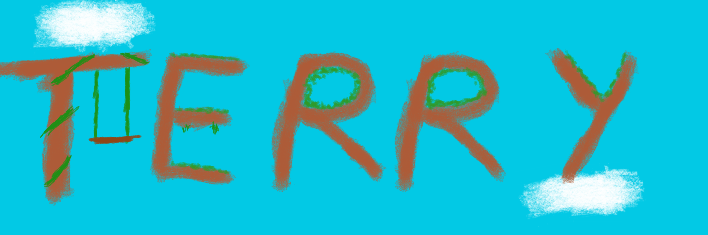
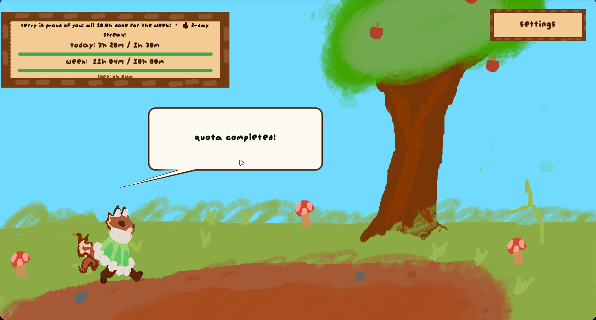
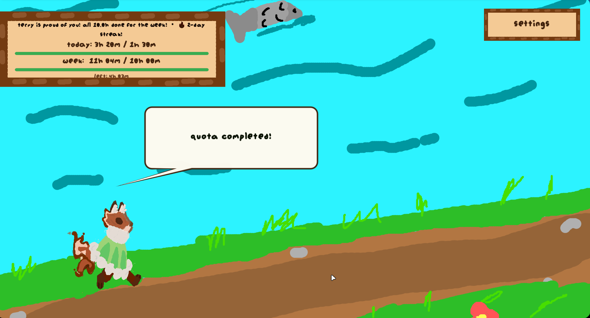
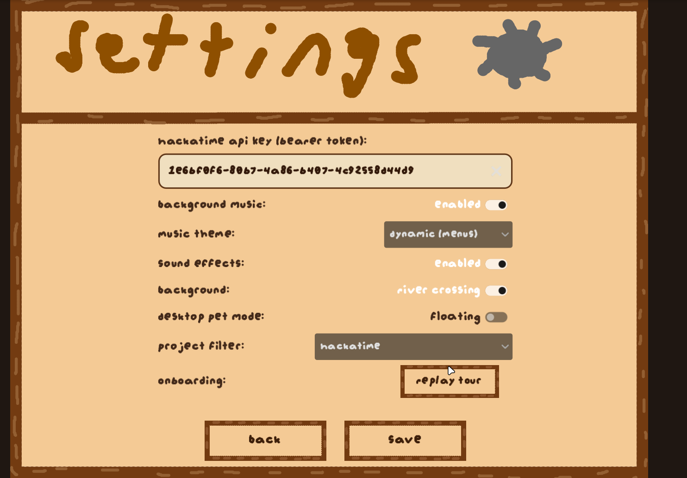
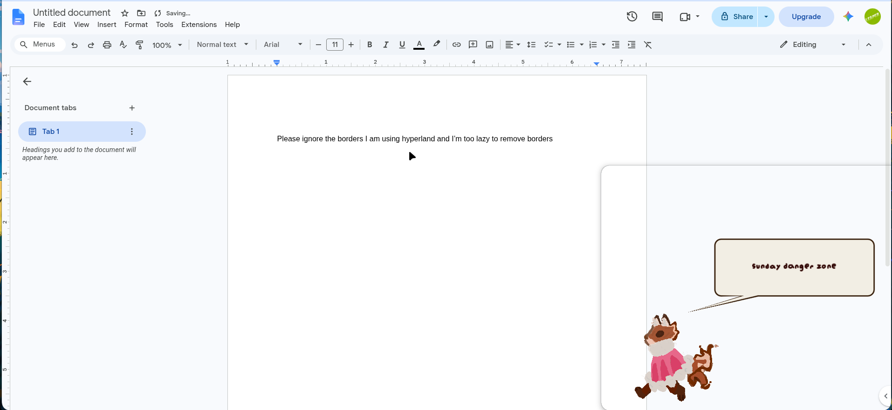

  

  # Terry — Your Terra Companion

  **A desktop companion that helps you stay on track with your Terra goals.**

Terry is a fox who keeps an eye on your coding time on [Terra](Terra.hackclub.com) through [Hackatime](https://hackatime.hackclub.com) and helps you stay on top of your daily and weekly goals. His colors change to show whether you're on track or falling behind.

## What Terry does

- Shows your coding time for today and this week.
- Tracks your daily and weekly goals.
- Changes color to make your progress easy to spot.

## features Terry Offers
1. hackatime tracking (duh)
2. specific project tracking in hackatime (picking the exact project you want to track)
3. Terry is incredibly cute 
4. has 2 backgrounds 
5. art made by people who should not touch a canvas (very cool) (warning may singe your eyeballs)
6. stolen music from terra (LOL) togglable 
7. can enter desktop Pet Mode (no background and very customizable)
8. animated buttons and movements (I'm just trying to fill this list bare with me)

## How to use Terry
1. Launch Terry.
2. Follow the the Tour! 
3. add your API key in the settings (I promise he won't misuse it)
4. check Terry's color and progress to see how you're doing.

## compatibility 
1. linux yes
2. windows yes
3. mac NO
4. WEB yesn't some features missing probably and untested

## How to setup and use the desktop pet mode !
1. go to settings 
2. click on floating switch under desktop pet mode
3. you can configure him to switch the way he's facing by pressing F and dragging him wherever you need he's also resizable! 
4. you can also resize his speech bubble by scrolling on it 
5. you can leave desktop pet mode by clicking ESC on your keyboard

[here's an example](image.png)  (the weird line in the photo is due to me using hyprland but this shouldn't be an issue to other computers) 
> “I'm TERRIFIED you'll lose. Get it? cuz I'm Terry LOL”

## gallery 

## Credits 
1. Music - Terra creators 
2. art - by yours truely (heavily inspired by Terra) BTW everything was hand-drawn
3. AI assistance was used.

## editors note 
the python script you see is just earlier versions of this mess since I had no idea what I was doing LOL